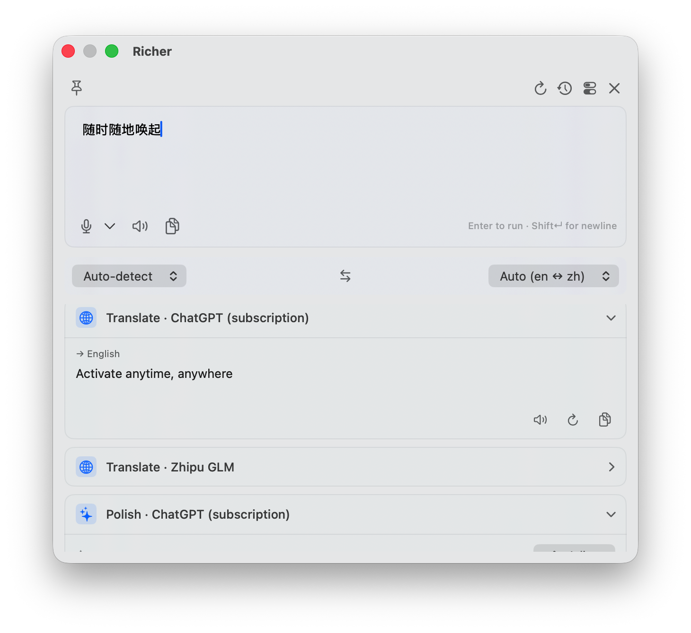
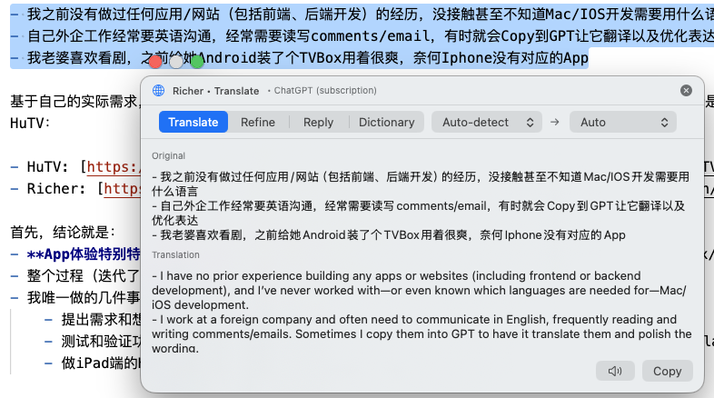

+++
title = '我用Codex写了Richer和HuTV两个App'
date = 2026-11-02T20:00:00+08:00
draft = false
tags = ['AI', 'Coding']
+++

AI技术发展太快了，从去年底到年初开始就有想用AI直接实现自己App的想法。先说下我的背景：

- 我之前没有做过任何应用/网站（包括前端、后端开发）的经历，没接触甚至不知道Mac/IOS开发需要用什么语言
- 自己外企工作经常要英语沟通，经常需要读写comments/email，有时就会Copy到GPT让它翻译以及优化表达
- 我老婆喜欢看剧，之前给她Android装了个TVBox用着很爽。奈何Iphone没有对应的App，家里还有个闲置的老Ipad 2018，刚好也想用起来。话说用AI把家里的闲置用起来是个很好的思路。

基于自己的实际需求，我决定用AI实现这两个App。最终结果，一个是Mac上的翻译/润色软件Richer，另一个是iPhone/iPad上订阅看剧客户端HuTV：

- HuTV: [https://github.com/xiahouzuoxin/HuTV](https://github.com/xiahouzuoxin/HuTV)
- Richer: [https://github.com/xiahouzuoxin/Richer](https://github.com/xiahouzuoxin/Richer)

首先，实际体验上来说：

- **App体验特别特别棒，超级爽**，可能因为都是直接按自己的需求做的。Richer个人体验比Bob更好，从开发出来到现在几乎每天自己都在用，HuTV也比TVBox/影视仓更符合我的使用习惯。
- 整个过程（迭代了几次）我没有改过/读过任何一行代码，包括最初的技术方案都是和AI讨论决定的
- 我唯一做的几件事情就是：
  - 提出需求和想法
  - 测试和验证功能是否符合预期（这个只要想法描述清楚，Codex 的 Computer use skill + Simulator 也基本可以胜任）
  - 做iPad端的HuTV时，配Apple ID，拿USB线连接Mac和iPad -- 真机下载安装也是让AI完成的

AI确实在革新人类开发应用的方式，尤其是工具类 -- 每个人都可以有独属于自己需求的App，千人千App的时代已经到来。但AI 确实没有取代「想做什么」这件事，反而让它变得更重要：想法 + 品味 + 验证由人负责，实现细节交给AI。

### [HuTV](https://github.com/xiahouzuoxin/HuTV)

> 开发环境碎碎念：
> - VSCode Codex插件，主要使用Codex GPT-6 Astra，偶尔5.6 Sol，整体开发效果差别不大
> - Codex Session累计Token消耗 ~ 2.71 亿，按API算$150左右，实际订阅成本更低
> - Iphone 17Pro Simulator，真机Ipad 2018
> - 也有些麻烦的地方，不好上架Apple Store，主要是涉及视频版权相关问题。所以要安装到Iphone和Ipad上使用，需要通过脚本打包未签名IPA并使用比如Sideloadly等方式实现自刷新

iPhone / iPad 原生视频订阅客户端，Swift + SwiftUI 实现。

- 支持 CMS JSON 点播、M3U / TXT 直播及兼容的 TVBox 配置
- AVPlayer 与 VLC 双播放内核，支持手势、倍速、自动连播、播放中换源
- 多源搜索、观看历史、豆瓣热门、订阅批量导入与自动刷新
- 通过 XcodeGen 管理工程，脚本打包未签名 IPA，配合 Sideloadly 安装

从初始化到 1.0.0 Ipad安装版本大约只用下班后晚上的3个小时完成。

<video src="image/index/HuTV-1.mov" controls muted playsinline preload="metadata" style="max-width:100%;"></video>

### [Richer](https://github.com/xiahouzuoxin/Richer)

> 开发碎碎念：
> - VSCode Codex插件，前期主要GPT-4，最近更新少量GPT-6 Astra
> - Mac app，完全它自己实现测试，很少人工干预
> - 相比Iphone App，Mac安装自用比较容易，但由于权限（比如OCR翻译等）限制，暂时不好上架

macOS 菜单栏写作/翻译助手，类似 Bob，但可以自由接入各种 LLM。

- 卡片范式：一张卡片绑定「一个模型 + 一个动作」，多卡并行对比结果
- 划词弹窗：全局快捷键翻译、润色、回复、查词，且不抢占原应用焦点
- 屏幕区域 OCR、语音输入、实时字幕、TTS
- 支持 API Key、本地 Ollama，以及 ChatGPT 订阅登录

